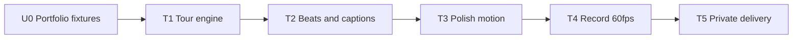

# Demo Tour and video plan (for the payments partner)

Status: draft, 18 Nov 2026. Goal: a 60 to 90 second partner clip that pans smoothly
across the Portfolio tab with captions, so the partner can show their team what FVC tracks and where
their settlement feed plugs in.

Depends on: [`ui-plan.md`](./ui-plan.md) (Portfolio tab), [`system.md`](./system.md).

---

## 1. What we are making

Not a Loom click-through. A short product demo:

- Fullscreen Portfolio UI (existing dapp chrome, no new visual kit)
- Smooth pan / spotlight from region to region at 60fps
- One caption per beat (lower-third)
- Private link for the partner; say "payments partner", not their name, unless they consent in writing

Audience: The partner's compliance / product. SMEs never appear in the UI.

---

## 2. Approach: in-app Demo Tour, then record

We build the camera work into the app. Recording is "press Play tour" plus a 60fps capture.
That keeps every take identical and works on Linux (no Screen Studio).



| Phase | Deliverable | Done when |
|---|---|---|
| T1 | Tour engine on Portfolio | Done: Play / Pause / Restart; spotlight; caption bar |
| T2 | Scripted beats on fixture loans | Done: partner script on Cutmap Portfolio (dark default, light toggle) |
| T3 | Motion polish | Review in browser; then record |
| T4 | Recording recipe | One command or OBS preset; 1080p60 file on disk |
| T5 | Delivery pack | Unlisted link + 5-line note the partner can forward |

---

## 3. Hard rules (keep it looking like FVC, not a new product)

- Reuse Portfolio / Staking / Vesting tokens only: cyan `#38BDF8`, glass `Card`, Inter / Space Grotesk
- Spotlight: dim overlay + clear cutout around the target; no purple glow kits, no emoji captions
- Caption bar: fixed lower third inside the content column, `bg-black/80`, border `white/10`, cyan accent rule
- Tour runs only when `NEXT_PUBLIC_DEMO_MODE=true` (or a `?tour=1` query on non-mainnet). Off on production mainnet
- No new fonts, no new icon pack, no separate demo microsite

---

## 4. Caption script (final cut ~75 seconds)

| Beat | Seconds | Camera target | Caption |
|---|---|---|---|
| 1 | 0 to 8 | Portfolio header + Demo badge | "FVC Portfolio: what we track on each SME facility." |
| 2 | 8 to 18 | Summary strip | "Drawn, outstanding, and collateral held. All in GBP terms." |
| 3 | 18 to 30 | Active loan row | "Each facility can be paid out in tranches. The SME never uses this screen." |
| 4 | 30 to 45 | Collateral stat on loan detail | "Collateral arrives as USDC after the SME pays GBP. We hold it until the loan is repaid." |
| 5 | 45 to 60 | Payments partner feed | "Partner settlements land here with a reference. This feed is simulated until the partner is live." |
| 6 | 60 to 72 | Repaid example (auto-switch loan 2) | "When the facility is repaid, collateral is released back through the partner to the SME's bank." |
| 7 | 72 to 80 | Hold on repaid + released state | "Same numbers will match on-chain. Etherscan is the public check." |

Voice-over is optional. Prefer captions only so the partner can watch muted with their team.

---

## 5. Phase T1: tour engine

Files (proposed):

| File | Role |
|---|---|
| `dapp/src/components/portfolio/DemoTour.tsx` | Play controls, beat timer, caption, overlay |
| `dapp/src/constants/demoTourBeats.ts` | Beat list: `id`, `durationMs`, `targetId`, `caption`, optional `onEnter` |
| `dapp/src/components/cards/PortfolioCard.tsx` | Add stable `data-tour-id` anchors; host DemoTour |

Behaviour:

- [x] `data-tour-id` on: `header`, `summary`, `loan-list`, `loan-1`, `collateral`, `partner-feed`, `tranches`, `repayments`, `loan-2`
- [x] Overlay covers the viewport content area; spotlight rectangle tracks `getBoundingClientRect()` of the target, with 12px padding and 16px radius (match card radius)
- [x] Smooth scroll: `element.scrollIntoView({ behavior: 'smooth', block: 'center' })` then hold
- [x] Caption updates on beat change; fade 150 to 200ms (CSS opacity only)
- [x] Respect `prefers-reduced-motion: reduce`: jump, no pan, captions still advance
- [x] Controls: Play, Pause, Restart, small "Demo tour" outline `Button` top-right of Portfolio header

**Gate:** clicking Play walks beats 1 to 3 without console errors; spotlight follows targets.

---

## 6. Phase T2: full beat script on fixtures

- [x] Encode the section 4 script in `demoTourBeats.ts`
- [x] Beat 6 calls the same state change as "Show repaid example" (select loan 2)
- [x] Beat 5 keeps partner panel badge `Not connected` visible in the spotlight
- [x] Total autoplay duration 75 to 90 seconds
- [x] Idle loop off: stop on last beat; Restart returns to loan 1 and beat 1

**Gate:** hands-free run tells the full collateral story once.

---

## 7. Phase T3: motion polish

- [ ] Target 60fps in Chrome Performance panel while touring (no multi-second long tasks)
- [ ] Spotlight position updates with `requestAnimationFrame` during scroll only
- [ ] No layout shift when caption appears (reserve caption height)
- [ ] Side-by-side screenshot: Portfolio at rest vs StakingCard; same family
- [ ] Hide wallet noise if disconnected (tour does not require a wallet)

**Gate:** Igli watches one run and signs off "looks like our app, not a template".

---

## 8. Phase T4: record at 60fps

Linux recipe (ffmpeg is available on this machine):

1. Run dapp: `cd dapp && NEXT_PUBLIC_DEMO_MODE=true npm run dev`
2. Open `#/portfolio?tour=1` in Chrome, fullscreen (F11), 1920x1080 window
3. Start capture, then click Play (or autoplay when `?tour=1`)

Example ffmpeg (Window id / region filled in at record time):

```bash
# Replace :0.0+x,y with the browser content region from `xdotool` / `slop` if installed
ffmpeg -video_size 1920x1080 -framerate 60 -f x11grab -i :0.0 \
  -c:v libx264 -preset slow -crf 18 -pix_fmt yuv420p \
  ~/Videos/fvc-portfolio-demo-$(date +%Y%m%d).mp4
```

Checklist before hit record:

- [ ] Notifications off, dark browser theme, bookmarks bar hidden
- [ ] No real SME names in fixtures
- [ ] Demo badge visible
- [ ] One clean take; do not talk over captions unless you add VO later

**Gate:** a 1080p60 file exists; captions readable on a laptop screen.

Fallback if desktop grab is painful: record in Chrome DevTools Recorder is not enough. Prefer OBS once installed, same 60fps settings, or film on a Mac with Screen Studio using the same in-app tour (tour still does the pans).

---

## 9. Phase T5: deliver to the partner

Short note he can forward:

> Portfolio walkthrough (demo data). Shows what FVC tracks on each facility, how collateral is held after GBP is settled to USDC, and where the payments partner feed will appear. Simulated until the partner is live. ~80 seconds, captions on, no audio required.

- [ ] Upload unlisted (Loom, Drive, or YouTube unlisted)
- [ ] Do not name the partner in the video or the note unless written consent
- [ ] Keep the mp4 in `~/Videos/` (not the public repo)

---

## 10. Out of scope

- Real partner API in the tour (placeholder only until P10 / partner sandbox)
- SME-facing UI
- Rebuilding Portfolio in a different design system for the video
- Public marketing site embed

---

## 11. Definition of done

- Play on `#/portfolio` runs the full caption script hands-free
- Recording is 60fps, captions legible, UI matches the live dapp
- The partner has a private link and can show their team without you on the call
