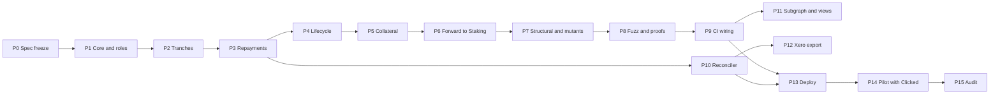

# Development plan: from Loan Registry to a working product

Status: draft, 8 Nov 2026. Goal: a UK SME can receive funding in tranches, repay in GBP through
Clicked, and have every repayment recorded on-chain, reported to Xero, and paid out to stakers.

Read with:

- [`docs/specs/system.md`](./system.md): actors, flows, requirements, open decisions
- [`contracts/LOAN_REGISTRY.md`](../../contracts/LOAN_REGISTRY.md): contract design
- [`contracts/INVARIANTS.md`](../../contracts/INVARIANTS.md): numbered properties
- [`contracts/SOL_DEVELOPMENT.md`](../../contracts/SOL_DEVELOPMENT.md): the TDD and security workflow every phase follows

---

## 1. How this plan is executed

Each phase is written so an agent can build it end to end without guessing. The rules:

1. **One phase, one branch, one PR.** Branch name `loan-registry/pN-<slug>`.
2. **Red, green, refactor.** Write the failing tests listed for the phase first, then the smallest
   code that passes them. Never write ahead of the tests.
3. **A phase is done only when its gate is green.** Gates are commands with expected results, not
   judgement calls. The next phase does not start until the previous PR is merged.
4. **Spec first.** If code needs a rule the spec does not have, stop, add the rule to
   `LOAN_REGISTRY.md` and `INVARIANTS.md` in the same PR, and flag it in the PR description.
5. **Never touch mainnet or the Safe.** Agents deploy to local Hardhat and Sepolia only. Mainnet
   steps (phase 13) are run by a human from the script's printed output.
6. **Stop and ask** when a phase depends on an open decision that has not been answered. Section 3
   lists which phase each decision blocks.

Pre-PR command set, run from `contracts/` (the gate for every contract phase):

```bash
npx hardhat compile
npx hardhat test test/*[ct].ts
forge test
slither . --exclude-medium --fail-high
COVERAGE=true npx hardhat coverage --testfiles "test/*[ct].ts" && npx ts-node scripts/check-coverage.ts
```

From phase 8 on, add `FOUNDRY_PROFILE=deep forge test`, `FOUNDRY_DYNAMIC_TEST_LINKING=false medusa fuzz --timeout 600`
and `npx ts-node scripts/mutate.ts`.

---

## 2. Phase map



| Phase | Deliverable | Target |
|---|---|---|
| P0 | Spec, invariants and mutation labels final for v1 | 10 Nov |
| P1 to P6 | `LoanRegistry.sol` with full Hardhat suite | 17 Nov |
| P7 to P9 | Structural tests, mutants, Foundry, Medusa, Halmos, CI | 21 Nov |
| P10, P12 | Reconciler with Clicked mock feed, Xero export | 24 Nov |
| P11 | Subgraph entities, risk view | 26 Nov |
| P13 | Sepolia deploy, fork rehearsal, mainnet deploy | 28 Nov |
| P14 | First SME end to end through Clicked | When Clicked is live |
| P15 | Hashlock scope add-on | After P14 |

The late November target covers what was promised to Clicked: Loan Registry, reconciler and CI
security testing.

---

## 3. Open decisions and what they block

| Decision (see `system.md`) | Owner | Blocks | Default the build uses until answered |
|---|---|---|---|
| Fee on top of 1:1 repayment | Jaz | Nothing; it is a loan parameter | `feeGbp = 0` |
| Collateral trigger (three missed payments, or fraud only) | Jaz | Nothing; the Safe decides off-chain | Admin-only `claimCollateral` on `Defaulted` loans |
| D2 Payment reference format | Saeed | P10 parsing only | 32-byte hash of whatever string Clicked sends |
| D3 USDC only, or USDT too | Saeed | P6 swap step | Both allowed in the registry; USDT swapped by the Safe before Staking |
| D4 Chargebacks | Saeed | P14 | Clicked settles only final payments (R8) |
| D5 Agreement hash, consumer credit | Legal Bison | P13 mainnet | Hash on-chain; no sole traders in the pilot |
| D6 Clicked entity and licence | Saeed | P14 | None; pilot does not start without it |
| D7 Principal and income split, Xero layout | Dan | P12 final columns | One line per transaction, Xero default columns |

---

## 4. Phase 0: spec freeze for v1

Update the specs so they describe exactly what will be built. No code.

**v1 loan model** (from the whitepaper and Igli's decisions of 8 Nov):

- A loan is a **facility** in GBP. FVC pays it out in any number of **tranches** up to `facilityGbp`.
- The business owes **1:1 what it drew**, plus an optional fixed `feeGbp`:
  `owedGbp = disbursedGbp + feeGbp`.
- Repayments are any amount, any time, in USDC or USDT, each carrying the GBP amount Clicked
  collected. A repayment may never take `repaidGbp` past `owedGbp`.
- A loan becomes `Repaid` when drawing is closed (all of the facility drawn, or `closeFacility`
  called) and `repaidGbp == owedGbp`.
- **Collateral** (small grants, 10 to 30 percent per the whitepaper) is deposited as USDC or USDT,
  held by the registry, kept separate from repayments, released when the loan is `Repaid`, or
  claimed against the outstanding balance when it is `Defaulted`. Any excess after a claim is
  released back.

**Tasks**

- [ ] `LOAN_REGISTRY.md`: replace `repaymentCapGbp` with `feeGbp` and the owed formula; add
      `drawingClosed`, `closeFacility`, the collateral functions and storage; update the flow diagram.
- [ ] `INVARIANTS.md`: rewrite rules 2, 3 and 14 for `owedGbp`; add collateral rules C1 to C6
      (below); add rule 15b for `closeFacility`.
- [ ] Mutation labels `L01` to `L24` listed in `LOAN_REGISTRY.md` (section 5 below).
- [ ] Threat model section in `LOAN_REGISTRY.md` (SOL_DEVELOPMENT phase 0 checklist).
- [ ] `system.md`: decision log rows for 1:1 repayment and collateral; collateral flow diagram.
- [ ] `test/LoanRegistry.test.ts`: first test uses `createLoan(agreementHash, smeRef, facilityGbp, feeGbp)`.

**Collateral invariants**

- C1. Collateral is backed: for every token, `balanceOf(registry) >= (totalReceived - totalForwarded) + totalCollateralHeld`.
- C2. `forward` can never move collateral: `forward` amount is bounded by `totalReceived - totalForwarded`.
- C3. Collateral is released only on `Repaid` or `WrittenOff` loans.
- C4. Collateral is claimed only on `Defaulted` loans, never more than is held for that loan and token,
  and never crediting more GBP than is outstanding.
- C5. `collateralHeld[loan][token]` changes only through deposit, release and claim.
- C6. Each collateral reference is used at most once (shared with the settlement reference set).

**Gate:** a reviewer can list every function, its role, and the invariants it touches from the
specs alone. Igli approves the PR.

---

## 5. Contract phases (P1 to P6)

All code in `contracts/src/loan/LoanRegistry.sol`, Solidity 0.8.24, OpenZeppelin `AccessControl`,
`Pausable`, `ReentrancyGuard`, `SafeERC20`. Not upgradeable. Custom errors named
`LoanRegistry__<Reason>`. Every state change emits an event.

### P1: core, roles, allowed tokens, loan creation

| Item | Detail |
|---|---|
| Functions | constructor(admin), `grantOriginator`, `grantRecorder`, `grantDistributor`, `setAllowedToken`, `createLoan`, `pause`, `unpause`, views `loans`, `loanCount` |
| Tests (`LoanRegistry.test.ts`) | Happy path create; ids start at 1 and increase; zero facility reverts; zero agreement hash reverts; zero smeRef reverts; wrong role reverts for every admin function; paused blocks `createLoan`; views work while paused |
| Invariants | 15, 16, 18, 19, 20 |
| Mutation labels | L01 originator check, L02 zero facility check, L03 pause check on create |

### P2: tranches

| Item | Detail |
|---|---|
| Functions | `recordDisbursement(loanId, gbpAmount, token, tokenAmount, payoutRef, to)`, `closeFacility(loanId)` |
| Behaviour | Pulls `tokenAmount` from the caller and sends it to `to` (Clicked) in the same call; adds `gbpAmount` to `disbursedGbp`; closes drawing automatically when `disbursedGbp == facilityGbp` |
| Tests | Several tranches add up; exactly the facility succeeds, one penny over reverts; reused `payoutRef` reverts; disallowed token reverts; zero amounts revert; not `Active` reverts; after `closeFacility` further tranches revert; balances of caller and `to` move by `tokenAmount` |
| Invariants | 15a, 15b, 16 |
| Mutation labels | L04 facility bound, L05 payoutRef once, L06 drawing closed check, L07 token allowlist on tranche |

### P3: repayments

| Item | Detail |
|---|---|
| Functions | `recordRepayment(loanId, gbpAmount, token, tokenAmount, settlementRef)`, views `owedGbp`, `outstandingGbp` |
| Behaviour | Pulls `tokenAmount` into the registry; credits `gbpAmount`; updates `loanReceived`, `totalReceived`, `totalRepaidGbp`; marks `settlementRef` used; moves to `Repaid` when drawing is closed and `repaidGbp == owedGbp` |
| Tests | Partial repayments accumulate; mixed USDC and USDT on one loan; exact owed amount moves to `Repaid`; one penny over reverts; repaid in full while drawing still open stays `Active`, then `closeFacility` moves it to `Repaid`; duplicate reference reverts; disallowed token reverts; zero GBP or zero token amount reverts; recorder only; paused reverts; repayment on `Repaid` or `WrittenOff` reverts; on `Defaulted` succeeds; registry balance equals received minus forwarded |
| Invariants | 1 to 9, 13, 14 |
| Mutation labels | L08 settlementRef once, L09 owed bound, L10 token allowlist on repay, L11 transfer pulled before credit, L12 auto `Repaid` transition, L13 recorder check |

### P4: lifecycle

| Item | Detail |
|---|---|
| Functions | `markDefault`, `cure`, `writeOff` |
| Tests | Every allowed transition; every disallowed transition reverts (table-driven over all 4 x 4 pairs); admin only; `Repaid` and `WrittenOff` are terminal |
| Invariants | 12, 13, 17 |
| Mutation labels | L14 default only from `Active`, L15 cure only from `Defaulted`, L16 write-off only from `Defaulted`, L17 admin check on lifecycle |

### P5: collateral

| Item | Detail |
|---|---|
| Functions | `depositCollateral(loanId, token, tokenAmount, gbpAmount, ref)`, `releaseCollateral(loanId, token, tokenAmount, to)`, `claimCollateral(loanId, token, tokenAmount, gbpAmount, ref)`, view `collateralHeld(loanId, token)` |
| Behaviour | Deposit pulls tokens in and records GBP value. Release sends to `to` (Clicked, for the refund to the business) only on `Repaid` or `WrittenOff`. Claim moves collateral into repayment accounting on a `Defaulted` loan, crediting `gbpAmount` against the outstanding balance |
| Tests | Deposit and release round trip; release before `Repaid` reverts; claim on `Active` reverts; claim more than held reverts; claim crediting more GBP than outstanding reverts; claim that clears the balance followed by release of the excess; `forward` cannot touch collateral; duplicate reference reverts |
| Invariants | C1 to C6 |
| Mutation labels | L18 release status check, L19 claim status check, L20 claim bounded by held, L21 claim bounded by outstanding, L22 collateral excluded from forward |

### P6: forward to Staking

| Item | Detail |
|---|---|
| Functions | `forward(token, amount, to)` |
| Behaviour | Distributor sends repaid tokens to `to`. In v1 `to` is the Safe, which then swaps USDT to USDC if needed and calls `Staking.notifyRewardAmount` (Staking pulls from its owner, the Safe) |
| Tests | Bounded by `totalReceived - totalForwarded`; distributor only; paused reverts; end-to-end test: repay, forward to a Safe signer, `notifyRewardAmount`, staker earns over 7 days (uses the real `Staking.sol`) |
| Invariants | 6, 7, 8, C2 |
| Mutation labels | L23 forward bound, L24 distributor check |

**Gate for P1 to P6:** the pre-PR command set is green for each phase; Slither has no high
findings; every label in the phase has a test that fails when the guard is removed (checked by hand
until P7 automates it).

---

## 6. Hardening phases (P7 to P9)

### P7: structural tests, mutation guards, coverage floor

- [ ] `test/LoanRegistry.structural.test.ts`: many loans at once, interleaved tranches and
      repayments across loans and tokens, totals checked after every step against a TypeScript model.
- [ ] Token edge cases: 6 and 18 decimal mocks; a token that returns `false`; a fee-on-transfer token
      must be rejected or fail loudly (never credited at face value).
- [ ] `scripts/mutate.ts`: add `LOAN_REGISTRY` and mutants `L01` to `L24`, matching the labels.
- [ ] `scripts/check-coverage.ts`: add `"loan/LoanRegistry.sol": { lines: 100, statements: 100, functions: 100, branches: 95 }`.

**Gate:** `npx ts-node scripts/mutate.ts` kills every `L` mutant and the overall score stays at or
above 80 percent; coverage floor met.

### P8: Foundry, Medusa, Halmos

- [ ] `test-fuzz/LoanRegistryInvariants.t.sol`: `LoanRegistryHandler` with a no-argument
      constructor; actions: create, tranche, close, repay (including reused references and
      overpayments), default, cure, write-off, deposit, release, claim, forward, pause, unpause;
      ghost totals per token.
- [ ] One `prop_*` per invariant 1 to 20 and C1 to C6; `invariant_*` wrappers for Foundry.
- [ ] `medusa.json`: add `LoanRegistryHandler` to `targetContracts`.
- [ ] `test-fuzz/symbolic/LoanRegistrySymbolic.t.sol`: exactly-once crediting, owed never
      exceeded, status machine, collateral never released early. Anything the solver cannot finish
      goes in `LoanRegistrySymbolicSlow`.

**Gate:** `FOUNDRY_PROFILE=deep forge test` and a 10 minute Medusa run are clean locally;
`halmos --match-contract 'LoanRegistrySymbolic$'` passes.

### P9: CI wiring and CI health

The existing workflows pick the new suites up automatically: `ci.yml` runs `test/*[ct].ts` and
`forge test`, `nightly-fuzz.yml` runs the deep profile and Medusa over `medusa.json`, and
`weekly-security.yml` runs `mutate.ts` and Halmos on `Symbolic$`. Changes still needed:

- [ ] Harden the Foundry install. Nightly and weekly runs on 8 Nov failed because GitHub returned
      504 while `foundry-toolchain` downloaded `foundryup`. Pin a Foundry version and add a retry
      (a second `foundry-toolchain` step with `if: failure()`), or cache the binaries.
- [ ] Move actions off Node 20 (`checkout`, `setup-node`, `upload-artifact` to current majors).
- [ ] Add a status badge for the Loan Registry suites in `README.md`.
- [ ] `INVARIANTS.md`: Loan Registry row in the "Bugs found via invariants" table (empty to start).

**Gate:** one green run each of `contracts`, `nightly-fuzz` and `weekly-security` (started with
`workflow_dispatch`) on the merged branch.

---

## 7. Off-chain phases

### P10: reconciler

New package `reconciler/` (TypeScript, Node 22, `vitest`, `viem`, Safe `protocol-kit` and `api-kit`).
Spec: write `docs/specs/reconciler.md` first, including an activity diagram.

| Part | Job |
|---|---|
| Clicked adapter | Reads settlement messages (webhook or poll). Starts with a mock feed that follows the format proposed in `docs/specs/clicked-integration.md` |
| Chain watcher | Reads USDC and USDT transfers into the Safe and Loan Registry events |
| Matcher | Reference to `loanId` through the private mapping; checks amount, duplicates, owed bound and implied GBP to USD rate |
| Proposer | Builds the Safe batch (`approve` then `recordRepayment`) and proposes it to the Safe Transaction Service. Never signs |
| Reporter | Daily report: matched, unmatched, duplicate, overpaid, rate outliers |
| Private mapping | `loanId` to SME, stored off-chain with access limited to risk and accounting (R9). Not in git |

Tests: unknown reference is reported, never guessed; the same transfer is never proposed twice
(including after a restart); partial and over-payments flagged; rate outliers flagged; a forked
chain test with the mock Clicked feed driving the deployed registry end to end.

CI: new `reconciler` job in `ci.yml` (lint, typecheck, `vitest`).

**Gate:** fork test green; a proposed Safe batch decodes to exactly the expected calls.

### P11: subgraph and views

- [ ] `subgraph/`: entities `Loan`, `Tranche`, `Repayment`, `Collateral`, `Forward`, daily totals.
- [ ] Public dashboard data: lent, repaid, outstanding in GBP; tokens received (R10).
- [ ] Risk view (internal): per loan, repaid against owed, last repayment date, status, joined
      to the private mapping (R12).

### P12: Xero export

- [ ] Command in the reconciler that writes one Xero bank statement CSV per holding (Safe USDC,
      Safe USDT, Loan Registry) per period (R13).
- [ ] Every line ties to a transaction hash; test that the sum of a file equals the on-chain balance
      change for the period.
- [ ] Final column layout once Dan answers D7.

---

## 8. Release phases

### P13: deploy

- [ ] `scripts/deploy-loan-registry.ts`: deploys with the Safe as admin, prints the address and the
      Safe batch to grant roles and allow USDC and USDT.
- [ ] `test/LoanRegistry.e2e.ts`: mainnet fork with real USDC, USDT, Safe and Staking addresses.
- [ ] Sepolia deploy, verify on Etherscan, run the reconciler against it with the mock feed.
- [ ] Mainnet deploy by a human; Safe executes the role batch; verify source; add the address to
      `README.md` and `deployments-mainnet.json`.
- [ ] Deploy Staking (already written) when the first repayment is near.

### P14: pilot with Clicked

- [ ] Clicked entity and licence confirmed (D6).
- [ ] Clicked sandbox replaces the mock feed; one test settlement end to end.
- [ ] First SME: agreement signed, loan created, first tranche paid, first repayment recorded,
      forwarded, paid to stakers. Each step checked in the risk view and the Xero export.

### P15: audit

- [ ] Decide with Hashlock whether the Loan Registry joins the current scope.
- [ ] No "audited" wording anywhere until the final report is published.

---

## 9. Definition of done (the product)

- A £100k facility can be drawn in tranches, repaid in any pattern, closed, and every number is
  visible on Etherscan and the subgraph.
- Every repayment is backed by tokens the registry holds; the fuzzers and Halmos have not broken any
  invariant in a week of nightly runs.
- The reconciler proposes every matched repayment and reports everything else; the Safe signers only
  approve.
- Dan's team imports a month of activity into Xero without editing the file.
- Stakers receive repayments as USDC through Staking.
