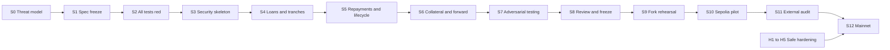

# Loan Registry: security-first build plan

Status: draft, 18 Nov 2026. Replaces sections 4 to 6 and the contract parts of section 8 of
[`development-plan.md`](./development-plan.md). The reconciler, subgraph and Xero phases there are
unchanged.

Read with:

- [`contracts/LOAN_REGISTRY.md`](../../contracts/LOAN_REGISTRY.md): contract design (updated in S1)
- [`contracts/INVARIANTS.md`](../../contracts/INVARIANTS.md): numbered properties
- [`contracts/SOL_DEVELOPMENT.md`](../../contracts/SOL_DEVELOPMENT.md): the TDD workflow every phase follows
- [`docs/specs/system.md`](./system.md): actors, flows, open decisions

Nothing in `contracts/src/loan/` exists yet. The only Loan Registry code is one failing test in
`contracts/test/LoanRegistry.test.ts`.

---

## 1. What the contract does

The Loan Registry is FVC's public ledger of SME loans. Every payout, repayment and collateral
movement is recorded in the same transaction that moves the stablecoins, so the record and the money
cannot disagree.

1. **Create a loan.** The Safe registers a signed agreement: a hash of the agreement PDF, a salted
   SME reference, the facility in GBP pence and an optional fixed fee (default 0). No personal data.
2. **Pay out in tranches.** Each tranche moves USDC or USDT from the Safe, through the registry, to
   the partner, which pays the SME in GBP. Total drawn never exceeds the facility.
3. **Take repayments.** The partner converts the SME's GBP to USDC or USDT and settles it to the Safe.
   The Safe records the repayment, which pulls the tokens into the registry. Each settlement
   reference counts once.
4. **Track what is owed.** `owedGbp = disbursedGbp + feeGbp`. A repayment that would pass it
   reverts. A loan is `Repaid` when drawing is closed and `repaidGbp == owedGbp`.
5. **Hold collateral.** Deposited into the registry and kept separate from repayments. Released to
   the partner (for the SME) when `Repaid` or `WrittenOff`; claimed against the outstanding balance when
   `Defaulted`, with any excess released.
6. **Lifecycle.** `Active`, `Defaulted` (and cure back to `Active`), `WrittenOff`, `Repaid`. The last
   two are terminal.
7. **Pay stakers.** Repaid tokens, never collateral, are forwarded to the Safe, which funds
   `Staking.notifyRewardAmount` (Staking pulls from its owner).
8. **Emergency stop.** Pause halts every state change; every view keeps working.

It does not choose who is funded, convert currencies, or store personal data.

---

## 2. Security decisions

Decided by Igli on 18 Nov 2026:

| # | Decision |
|---|---|
| SD1 | Every token leaving the registry goes only to an **approved destination** (the partner's deposit address, the Safe). Adding a destination waits **48 hours**. Removing one is immediate. |
| SD2 | **Outflow limits** in the contract: maximum facility per loan, maximum per payout, maximum total out per day. Lowering is immediate; raising waits 48 hours. Pilot values: £50,000 per loan, 32,000 USDC per payout (about £25,000), 65,000 USDC per day (about £50,000). |
| SD3 | **External audit before mainnet.** Sepolia pilot first, then Hashlock, then mainnet. |
| SD4 | The 2-of-4 Safe holds every operating role. No bot or hot wallet can move money; the reconciler only proposes Safe transactions. |
| SD5 | Not upgradeable. A change means a new deployment and a migration. |

Also decided by Igli on 18 Nov 2026, after discussion:

| # | Decision | Why |
|---|---|---|
| SD6 | **The Safe alone pauses.** A `GUARDIAN_ROLE` exists for reduce-only actions (pause, lower limits, remove destinations, disallow a token) but only the Safe holds it. A separate fast-pause wallet can be granted later through the timelock without a redeploy. | With 2 of 4 signers, honest signers have the same power as two attackers, and the daily limit caps the damage while they coordinate. Simpler for the pilot. |
| SD7 | **Unpause waits 48 hours.** | Otherwise two stolen keys simply unpause after the honest signers pause; the honest signers cancel the queued unpause. |
| SD8 | **Rate sanity band per token** on every recorded amount, set when the token is allowed: 1.10 to 1.50 per GBP for USDC and USDT, about 0.98 to 1.02 for a GBP stablecoin, and a CHF band for a CHF stablecoin. Changing a band waits 48 hours. | Catches the most likely costly typo: pounds entered as pence, or the reverse, is 100 times off. |
| SD9 | The 48-hour wait is OpenZeppelin's `TimelockController`, not custom code. | Audited, widely used, and every queued change is public on-chain before it can run. |
| SD10 | `recoverSurplus(token)` sends tokens sent to the registry by mistake to the Safe, never touching repayments or collateral. Admin only, so it waits 48 hours. | Staking cannot recover stray USDC (INVARIANTS.md). Better not to repeat that. |
| SD11 | **No on-chain correction** of a repayment recorded against the wrong loan in v1. | Simpler to audit; signers check the reconciler's match before signing. |
| SD12 | **Allowed tokens:** USDC, USDT, and GBP or CHF backed stablecoins if the partner settles them (told to the partner on 18 Nov 2026). Each token is stored with its decimals and its rate band; limits are set per token in its own units. | Igli's original ask to the partner was GBP or CHF stablecoins against a falling dollar. |

SD8 to SD10 were proposed defaults; Igli accepted them on 18 Nov 2026.

### Build decisions (Igli, 18 Nov 2026)

| # | Decision | Why |
|---|---|---|
| BD1 | **One Safe** holds every role. It is 2-of-4 today and moves to 3-of-5 before mainnet when the fifth signer joins. The contract stores only the Safe's address, so the threshold change needs no code. | Fewer places for keys to live. 3-of-5 means two stolen keys can no longer sign. |
| BD2 | **Ethereum mainnet**, the same chain as Staking and the FVC token. Sepolia first. | Staking and the Safe already live there. |
| BD3 | Solidity 0.8.24 and **OpenZeppelin 4.9**, as in the rest of `contracts/`. | One library version to audit; Staking and Sale already use it. |
| BD4 | **A single contract** with internal libraries; no proxy, no satellite contracts. | Smallest audit surface; one address to approve and monitor. |
| BD5 | **Custom errors only**, named `LoanRegistry__<Reason>`. NatSpec on every external function. | Cheaper reverts and tests that match the exact error. |
| BD6 | Design reference: **Centrifuge** (on-chain record of real-world loans, off-chain servicing). | The closest audited prior art for this model. |
| BD7 | **Fixed fee** per loan (`feeGbp`, default 0): `owedGbp = disbursedGbp + feeGbp`. No interest maths on-chain. | No rounding or time maths to get wrong; any interest is agreed off-chain and set as the fee. |
| BD8 | **An overpayment reverts.** The excess is refunded to the SME off-chain by the partner. To confirm with the partner. | The registry never holds money it cannot attribute. |
| BD9 | **The Safe swaps** USDT and any non-USDC stablecoin to USDC before funding Staking. | Staking pays rewards in one token; no swap code in the registry. |
| BD10 | **Per-loan salt** for `smeRef`, kept off-chain with the private loan-to-SME mapping. | The same SME's loans cannot be linked on-chain. |
| BD11 | Keep the SD2 pilot limits. | They match the first facilities. |
| BD12 | Assurance adds **Aderyn** next to Slither, an **independent AI security review** on every phase PR, and an **Immunefi bug bounty** after mainnet. | Each tool catches different classes of bug; the bounty keeps review going after the audit. |
| BD13 | Monitoring: **Tenderly alerts** plus the reconciler's daily report. | Alerts for the events in S10; the report for the books. |
| BD14 | **One PR per phase**, each approved by Igli before the next starts. | Small reviews; no phase builds on unreviewed code. |

### What the limits protect, and what they do not

The limits and approved destinations protect **money the registry holds**: repayments waiting to be
forwarded and collateral. With 2 stolen Safe keys, an attacker can take at most one day's limit from
the registry, and only to the Safe or the partner, before the honest signers pause.

They do **not** protect money sitting in the Safe itself. Whoever controls the Safe can send its
funds anywhere without touching the registry. That risk is covered by the Safe hardening track (H1
to H5 in section 6), not by this contract.

---

## 3. Threat model

| # | Threat | Impact | Control |
|---|---|---|---|
| T1 | 2 of 4 Safe keys stolen, or signers tricked into signing a malicious transaction (the Bybit pattern, Feb 2025) | Registry funds stolen; Safe treasury stolen | SD1, SD2, SD7 for the registry (honest signers pause and cancel queued changes); H1 to H5 for the Safe |
| T2 | Reconciler server compromised | Malicious transactions proposed | It cannot sign. Signers verify each batch independently (H3) |
| T3 | Wrong amount entered (pence vs pounds, wrong token amount) | Loan books wrong, overpayment | SD8 band; owed bound; reconciler checks before proposing |
| T4 | Repayment recorded against the wrong loan | Wrong loan shows repaid | Settlement reference once only; reconciler report; signer review. No on-chain undo in v1 (section 9, Q2) |
| T5 | Same settlement counted twice | Phantom repayment | `settlementRef` used once (invariant 1) |
| T6 | Token quirks: USDT's non-standard `approve` and return values, a fee switched on, a token that returns `false` | Credited more than received | `SafeERC20`; credit only the measured balance increase, and revert if it differs from `tokenAmount` (S5) |
| T7 | USDC or USDT issuer freezes the registry address | Funds stuck | Accepted risk; registry holds funds only briefly between repayment and forward |
| T8 | Reentrancy through a token callback | Double spend | Only allowlisted tokens; checks-effects-interactions; `nonReentrant` on every function that moves tokens |
| T9 | Collateral forwarded to stakers by mistake | SME's collateral lost | `forward` bounded by received minus forwarded (C2) |
| T10 | Approval abuse: registry pulls from someone other than the caller | Third-party funds taken | Tokens are only ever pulled from `msg.sender` (S6) |
| T11 | Privacy leak through on-chain data | SME identifiable | Salted `smeRef`, no personal data in storage or events (invariant 20) |
| T12 | A future guardian wallet stolen (none in v1) | Contract paused, changes cancelled | It can only reduce risk; the Safe replaces it through the timelock. A guardian cannot cancel its own removal (S8) |
| T13 | Gas griefing or unbounded loops | Functions become uncallable | No loops over user data; views read single entries |
| T14 | Front-running a recorder transaction | None expected | Recording needs a role and the caller's own tokens; note kept for the audit |

---

## 4. Roles and who can do what

| Role | Holder | Can do | Delay |
|---|---|---|---|
| `DEFAULT_ADMIN_ROLE` | `TimelockController` (proposer, executor and canceller: the Safe) | Grant and revoke roles, add destinations, raise limits, set the rate band, allow tokens, unpause, `recoverSurplus` | 48 hours |
| `ORIGINATOR_ROLE` | Safe | `createLoan`, `recordDisbursement`, `closeFacility` | None |
| `RECORDER_ROLE` | Safe | `recordRepayment`, `depositCollateral` | None |
| `RISK_ROLE` | Safe | `markDefault`, `cure`, `writeOff`, `claimCollateral`, `releaseCollateral` | None |
| `DISTRIBUTOR_ROLE` | Safe | `forward` (to an approved destination only) | None |
| `GUARDIAN_ROLE` | Safe (a fast-pause wallet can be added later through the timelock) | `pause`, lower limits, remove destinations, disallow a token | None |

Every function that moves tokens is also bound by SD1, SD2 and SD8, whoever calls it.

---

## 5. Security invariants

Added to `INVARIANTS.md` in S1, next to rules 1 to 20 and C1 to C6.

- **S1.** Every token transfer out of the registry goes to an approved destination.
- **S2.** For each token, total outflow in one UTC day never exceeds the daily limit in force.
- **S3.** No facility above the per-loan limit; no tranche above the per-payout limit.
- **S4.** Every recorded GBP and token pair is inside the rate band in force.
- **S5.** The token amount credited equals the registry's measured balance increase.
- **S6.** Tokens are only ever pulled from `msg.sender`.
- **S7.** Only the timelock can add destinations, raise limits, change the band, allow tokens, grant
  roles, unpause or recover surplus.
- **S8.** `GUARDIAN_ROLE` actions only reduce what is possible: they cannot unpause, raise a limit,
  add a destination or move tokens.
- **S9.** While paused, every state change reverts except `GUARDIAN_ROLE` reductions; every view works.
- **S10.** Solvency: for every token, balance is at least repayments held plus collateral held
  (combines invariant 6 and C1). `recoverSurplus` can only move the excess.
- **S11.** The only external calls are `transfer`, `transferFrom`, `balanceOf` and `decimals` on
  allowed tokens. A token's decimals are read once when it is allowed and stored with its rate band
  and limits.
- **S12.** No function loops over loans, tranches or repayments.

New mutation labels, on top of `L01` to `L24` from `development-plan.md`:

| Label | Guard removed |
|---|---|
| L25 to L27 | Destination check on tranche, release, forward |
| L28 | Per-loan facility limit |
| L29 | Per-payout limit |
| L30 | Daily outflow limit |
| L31, L32 | Rate band lower and upper bound |
| L33 | Measured balance check on incoming tokens |
| L34 | Guardian cannot unpause |
| L35 | Raise limit is admin only |
| L36 | Per-token decimals used when checking the rate band |
| L37 | `recoverSurplus` bounded by surplus |

---

## 6. Phases

One phase, one branch (`loan-registry/sN-<slug>`), one PR. A phase is done when its gate passes.
The pre-PR command set in `development-plan.md` section 1 applies to every contract phase.

### S0: threat model and security design

This document. **Gate:** Igli approves it. Section 2 decisions are all made.

### S1: spec freeze

- [ ] `LOAN_REGISTRY.md`: replace `repaymentCapGbp` with `feeGbp` and `owedGbp`; add `closeFacility`,
      collateral, destinations, limits, rate band, guardian role, timelock, `recoverSurplus`; this
      threat model; the role table from section 4; every event.
- [ ] `INVARIANTS.md`: rewrite rules 2, 3 and 14 for `owedGbp`; add 15b, C1 to C6 and S1 to S12.
- [ ] Full list of mutation labels `L01` to `L37`, each pointing at the invariant it protects.
- [ ] `system.md`: decision log rows SD1 to SD10.

**Gate:** a reviewer can list every function, its role, its delay and the invariants it touches from
the specs alone.

### S2: every test written first, all red

- [ ] `test/LoanRegistry.test.ts`: one `describe` per function. For each: happy path, wrong role,
      paused, zero amounts, wrong token, wrong destination, each limit at exactly the limit and one
      unit over, rate band edges, duplicate references.
- [ ] `test/LoanRegistry.security.test.ts`: timelock flows (queue, wait, execute; execute early
      reverts; Safe cancels), guardian role powers and non-powers, unpause delay, daily limit across
      midnight, lowering a limit mid-day, `recoverSurplus` bounds.
- [ ] `test/helpers/loanModel.ts`: a plain TypeScript model of the ledger, used by structural tests.
- [ ] Malicious token mocks: reentrant callback, returns `false`, fee on transfer, blacklist.

**Gate:** the suite compiles against an interface and fails only because the contract is missing.

### S3: security skeleton green

Built before any money feature, so every money path is written behind the controls.

- [ ] Roles, `TimelockController` wiring in the deploy fixture, guardian role, pause with delayed unpause.
- [ ] Approved destinations, per-token limits with daily buckets, per-token rate bands, allowed
      tokens with stored decimals, `_pullExact` (measured balance increase) and `_pushTo` (destination, limit and
      bucket checks in one place).

**Gate:** all security tests green; Slither clean; labels L25 to L37 each killed by a test.

### S4: loans and tranches

`createLoan`, `recordDisbursement`, `closeFacility`. Invariants 15, 15a, 15b, 16, S3. Labels L01 to L07.

### S5: repayments and lifecycle

`recordRepayment`, `owedGbp`, `outstandingGbp`, `markDefault`, `cure`, `writeOff`.
Invariants 1 to 14, 17. Labels L08 to L17.

### S6: collateral and forward

`depositCollateral`, `releaseCollateral`, `claimCollateral`, `forward`, `recoverSurplus`.
Invariants C1 to C6, 6 to 8, S10. Labels L18 to L24. End-to-end test with the real `Staking.sol`:
repay, forward to the Safe, `notifyRewardAmount`, a staker earns over 7 days.

**Gate for S4 to S6:** pre-PR command set green; each phase's labels killed.

### S7: adversarial testing

- [ ] Structural suite: many loans, interleaved tranches, repayments and collateral across both
      tokens, checked after every step against `loanModel.ts`.
- [ ] Foundry handler with three actors: an outsider with no roles, the Safe, and a compromised Safe
      that tries to drain. Ghost totals per token. One `prop_*` per invariant 1 to 20, C1 to C6, S1
      to S12. The compromised actor's total take must stay within the daily limits.
- [ ] Medusa on the same properties; Halmos for exactly-once crediting, owed never exceeded, status
      machine, collateral never released early, outflow never above the daily limit.
- [ ] Coverage floor 100 percent lines, statements and functions, 95 percent branches. Mutation: all
      37 labels killed, contract score at least 90 percent.

**Gate:** `FOUNDRY_PROFILE=deep forge test`, a 30 minute Medusa run and Halmos are clean.

### S8: review and freeze

- [ ] Slither with printers (`function-summary`, `vars-and-auth`) and Aderyn; every privileged write explained.
- [ ] Independent review of the diff by a separate security review agent; every finding fixed or
      answered in writing.
- [ ] Self-review against a public checklist (Solcurity), recorded in the PR.
- [ ] Tag the commit `loan-registry-v1-rc1`. From here, any change restarts S7.

### S9: mainnet fork rehearsal

- [ ] `test/LoanRegistry.e2e.ts` on a mainnet fork with real USDC, USDT, the real Safe and Staking.
- [ ] USDT's `approve` quirk, a simulated USDC freeze, the full deploy script, and the printed Safe
      batches decoded and checked call by call.
- [ ] Incident drill on the fork: two signers pause, cancel a queued destination and a queued
      unpause, then unpause through the timelock after 48 hours.

### S10: Sepolia pilot

- [ ] Deploy with the script, verify on Etherscan, wire the timelock exactly as mainnet.
- [ ] Monitoring: alert on every queued timelock call, `Paused`, `RoleGranted`, and any day's outflow
      above half its limit. Alerts go to all four signers, so two can pause quickly.
- [ ] The reconciler with the mock partner feed runs against it; the Portfolio dashboard reads it.
- [ ] Two weeks with nightly fuzzing green and no unexplained alert.

### S11: external audit

- [ ] Scope with Hashlock: `LoanRegistry.sol`, the deploy script, the timelock configuration.
- [ ] Fix findings; Hashlock reviews the fixes; final report published on `/security`.
- [ ] No "audited" wording anywhere before the final report.

### S12: mainnet

- [ ] A human deploys the audited commit byte for byte (compare bytecode against the tag).
- [ ] Safe at 3-of-5 (BD1).
- [ ] Pilot limits from SD2; the partner's address queued as a destination and live after 48 hours.
- [ ] Staking deployed when the first repayment is near.
- [ ] First real SME through the partner (development plan P14).

### H1 to H5: Safe hardening (in parallel, done before S12)

- [ ] **H1.** All four signers on hardware wallets; no signer keeps two keys.
- [ ] **H2.** An agreed pause procedure: which two signers can be reached at any hour, and how.
- [ ] **H3.** Every Safe transaction hash checked on a second device with an independent tool before
      signing. No blind signing.
- [ ] **H4.** A one-page signer runbook: what a normal batch looks like, what to refuse, who to call.
- [ ] **H5.** Decide whether the Safe treasury itself gets a delay or spending limit module.

---

## 7. Residual risks after all of the above

- A stolen Safe can still empty the Safe treasury unless H5 adds a delay there.
- GBP figures come from the partner and are not verifiable on-chain; the band only catches gross errors.
- A repayment recorded against the wrong loan cannot be reversed on-chain in v1.
- Circle or Tether can freeze the registry's balance.
- Legitimate urgent changes (a new partner address) wait 48 hours.

---

## 8. What this plan does not cover

Reconciler, subgraph, Xero export and the partner integration spec stay in `development-plan.md`
(P10 to P12) and `docs/specs/partner-integration.md` (to be written).

---

## 9. Questions for Igli

None open for the contract. Answered 18 Nov 2026: the Safe alone pauses (SD6), no on-chain
correction in v1 (SD11), SD7 to SD10 accepted, build decisions BD1 to BD14.

Open with the partner: overpayment refunds (BD8), settlement reference format, which stablecoins
it settles, and chargebacks (`system.md` D2 to D4).
