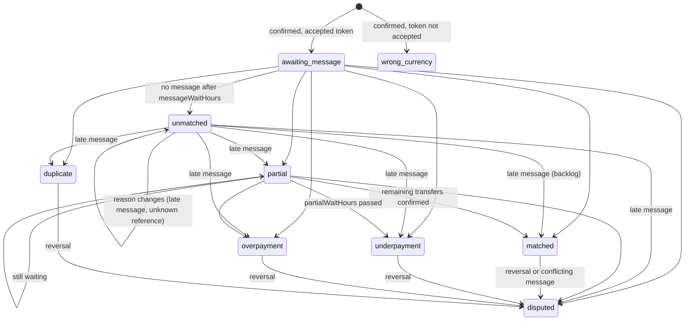

# Reconciler v1: specification

Status: draft, 20 Nov 2026. Code in [`reconciler/`](../../reconciler). Not reviewed independently.

The reconciler watches USDC and USDT arriving at the Treasury Safe, reads the ramp partner's
settlement messages, matches each payment to a loan by its reference, checks amount, rate and
duplicates, and writes the `recordRepayment` batch for the Safe signers. It never signs, never
proposes a Safe transaction and never holds a key. Everything it cannot decide goes into the daily
report for a person.

Read with: [`partner-integration.md`](./partner-integration.md) (trust boundaries, refs),
[`system.md`](./system.md) sections 6 to 8, [`contracts/LOAN_REGISTRY.md`](../../contracts/LOAN_REGISTRY.md).

---

## 1. Inputs, outputs, and what is trusted

| Input | Source | Trusted for |
|---|---|---|
| ERC-20 `Transfer` logs to the Safe | Ethereum RPC, confirmed blocks only | Token contract, amount, sender, tx hash, log index |
| Settlement, reversal and payout-return messages | Partner, through the adapter | Nothing until authenticated (HMAC, timestamp, delivery ID) and joined to a confirmed deposit |
| Loan book: payment reference to loan ID and loan currency | Local private file (R9), never committed | The mapping only |
| Registry views and `RepaymentRecorded` events | Ethereum RPC | Loan status, outstanding GBP, used refs, token band |
| Reference FX rates | Rate source in settings | The market sanity check |

| Output | Where | Who uses it |
|---|---|---|
| Safe Transaction Builder batch plus a signer summary | `out/batches/` | Signers review, then propose and sign in the Safe app themselves |
| Daily report | `out/reports/` | A person resolves every line |
| Append-only event log | `data/events.jsonl` | Auditors; the reconciler's own state is rebuilt from it |

The Safe's threshold and signer set are not read, used or checked.

## 2. Data model

All amounts are integers: token base units, fiat minor units (pence, centimes), GBP pence on-chain.
Rates are exact decimals (stablecoin per one unit of fiat), never floats.

- **Deposit**: `id = chainId:txHash:logIndex`, block number and hash, token contract, sender, amount.
- **Settlement message**: partner transaction ID, payment reference, payment method, fiat currency,
  fiat amount, partner fee, token contract, token amount, settled rate, the on-chain transfers the
  partner says carry it, settled time.
- **Reversal message**: its own partner ID, the original partner transaction ID, reason
  (`chargeback`, `direct_debit_return`, `clawback`), fiat amount.
- **Payout return message** (bounced payout): its own partner ID, the original payout ID, token
  contract, token amount, transfers.
- **Entry**: one per settlement that becomes recordable: `settlementRef`, loan ID, GBP credit, token
  amount, the deposit IDs it uses, the fiat paid, currency and rate, and `eligibleAt` (end of the
  hold). Status: `pending` (held until `eligibleAt`, or left out of a batch by the pre-check),
  `batched`, `recorded`, `cancelled` (reversed, disputed or no longer valid; never batched again).

`settlementRef = keccak256(abi.encode("fvc.settlement.v1", partnerTxId))`;
bounced payouts use `"fvc.return.v1"` (partner-integration.md section 5).

## 3. Matching

### 3.1 Match key

A deposit joins a message when the message's `transfers` list names the deposit's
`(txHash, logIndex)` (or `txHash` alone when that transaction has exactly one transfer to the
Safe). No amount-only matching: a deposit with no message naming it waits, then becomes
`unmatched`. A message joins a loan through the loan book by exact payment reference.

### 3.2 Checks, in order

1. **Token**: the deposit's contract is in the accepted list (by address, never by symbol). The
   message's token is the same contract.
2. **Amount**: the sum of confirmed deposits named by the message equals the message's token
   amount exactly.
3. **Sender**: if partner sender addresses are configured, every deposit comes from one of them.
4. **Internal rate**: `tokenAmount` is within tolerance of `(fiatAmount - fee) x rate`, converted
   to token units. Tolerance = `max(roundingUnits, expected x internalBps / 10_000)`.
5. **Market rate**: the settled rate is within `marketBps` of the reference rate for that currency
   and token on that day. With `requireReferenceRate` set, a missing reference rate fails.
6. **Loan**: the reference maps to exactly one loan; the loan currency equals the fiat currency;
   the loan currency is GBP (the registry is GBP only, section 8); the loan is `Active` or
   `Defaulted` with something paid out.
7. **Credit**: GBP credited = the pound value of the stablecoin received
   (`floor(tokenAmount / rate)`, decided 19 Nov) or the gross fiat paid (`creditBasis: gross`). It
   must not exceed the loan's outstanding balance minus credits already batched but not recorded.
8. **Registry band**: the credit and token amount pass the registry's own rate band check, read
   from `tokenConfig`, so the batch cannot revert on it.
9. **Ref**: `refUsed(settlementRef)` is false on-chain.

### 3.3 Hold

A recordable entry waits `holdHours[paymentMethod]` after `settledAt` before it can be batched,
so a direct-debit return or card chargeback inside that window stops it. Defaults are assumptions
until the partner answers: bank transfer 0, direct debit 72, card 0 (card relies on the partner
only settling final payments, R8).

## 4. State machine

Every confirmed deposit is in exactly one state.

| State | Meaning | Goes to the batch | Goes to the report |
|---|---|---|---|
| `awaiting_message` | Confirmed, no message yet, inside the wait | No | No |
| `matched` | All checks passed | Yes, once the hold ends | Only if blocked (for example a non-GBP loan) |
| `partial` | The message names transfers not all confirmed yet | No | No |
| `underpayment` | Deposits sum to less than the message says | No | Yes |
| `overpayment` | Deposits sum to more than the message says, or the credit exceeds what is outstanding | No | Yes |
| `unmatched` | No message, unknown sender, unknown reference, or loan not repayable | No | Yes (dust collapsed into one line) |
| `duplicate` | The settlement's ref is already used on-chain, recorded outside this reconciler (`ALREADY_RECORDED`) | No | Yes |
| `wrong_currency` | Not an accepted token contract (includes lookalike tokens) | No | Yes (dust collapsed) |
| `disputed` | Reversal, conflicting message, a second message claiming a deposit another message already claimed (`DEPOSIT_CLAIMED_TWICE`, both messages disputed), rate outside tolerance, currency mismatch, sender not the partner | No; voids any unsigned batch holding it | Yes |

`wrong_currency` and `disputed` are final for the reconciler: only a person resolves them. A
message that conflicts with an earlier one with the same partner ID (same ID, different content)
is never chosen between; both are reported and the deposit is `disputed`.

Messages have their own short life: `awaiting_deposit`, then `linked`, or `expired` after
`depositWaitHours` with no confirmed transfer (reported as "message with no deposit").

## 5. Ingestion and reorgs

- The confirmed head is the `finalized` block (default) or `head - depth`.
- Only blocks at or below the confirmed head are read. Nothing unconfirmed is ever classified, so
  a reorg above the confirmed head needs no handling.
- The cursor (last scanned block number and hash) advances per chunk, after that chunk's deposits
  are logged. A restart rescans from the cursor; deposits are keyed by ID, so rescanning is a no-op.
- On every run the stored hash of the cursor block is compared with the chain. A difference
  means a reorg deeper than the confirmation policy: the run stops with an alert and changes nothing.
- Backfill after downtime is the same scan over a longer range, in chunks.
- Logs read: every `Transfer` to the Safe from any contract (so lookalike tokens are seen and
  classified), and `RepaymentRecorded` from the registry.
- At start the reconciler reads `decimals()` of each accepted token and the registry's
  `tokenConfig` and refuses to run if either disagrees with settings.
- Registry reads (loan status, outstanding, `refUsed`, token band) are pinned to the cursor block,
  the same block the events were read to. Otherwise a batch executed in a block not yet confirmed
  would be subtracted twice (once in `outstandingGbp`, once as a batched entry) and an honest
  payment would look like an overpayment. The signer's `verify-batch` reads the latest block.
- Wait timers (`messageWaitHours`, `depositWaitHours`, `partialWaitHours`) start when the
  reconciler first sees the deposit or message, not at the block time. Downtime delays a report
  line; it never changes what is batched.

## 6. Idempotency

| Thing | Key | Effect of seeing it twice |
|---|---|---|
| Delivery | delivery ID plus body hash | Same body: ignored as a retry. Different body: rejected as a replay |
| Message | partner transaction ID plus content hash | Same content: ignored. Different content: conflict, `disputed` |
| Deposit | `chainId:txHash:logIndex` | Ignored |
| Entry | `settlementRef` (from the partner ID) plus the deposit IDs | At most one entry per partner ID and per deposit |
| On-chain | `refUsed` in the registry | A second `recordRepayment` with the same ref reverts |

The raw-delivery key is a hash of all headers, the body and the receive time. A forged or unsigned
copy of a genuine delivery therefore never shares its key, and cannot make the genuine one look
already handled. A failed authentication never uses up a delivery ID.

**Crash safety.** Every decision is an event appended (and fsynced) before anything depends on it,
and state is rebuilt only from the log. Where one decision is several events, they are ordered so
that a crash between them is repaired by the next run: the entry is logged before its deposits
become `matched`; a deposit is disputed before its batch is voided and its entry cancelled. Batch
files are written before `BatchWritten`, and their content depends only on the items, so a rerun
writes the same files. A test crashes a run after every possible record and checks the final state
equals an uninterrupted run. One process at a time: the CLI takes `data/.lock`.

## 7. Reversals

| Event | Before the entry is recorded on-chain | After it is recorded |
|---|---|---|
| Chargeback, direct-debit return, clawback | Deposit becomes `disputed`; the entry is cancelled; an unsigned batch holding it is voided (report says do not sign it); its other items are released to the next batch | Cannot be undone on-chain in registry v1 (SD11). Reported as `CORRECTION_REQUIRED`; the three-way check keeps alerting until a person resolves it |
| Conflicting message (same partner ID, different content) | Same as a reversal, reason `MESSAGE_CONFLICT` | Same as a reversal |
| Bounced payout (stablecoin returned) | `bouncedPayoutPolicy: report` (default): reported. `record_as_repayment`: recorded against the tranche's loan with the return ref and the tranche's GBP, only when the returned amount equals the tranche's token amount exactly; anything else is reported | Same as a repayment |

A reversal or conflict applies to every deposit any version of the message names, linked or not
yet, and is re-applied every run, so a deposit confirmed after the reversal arrives is disputed too.
The reconciler never writes an on-chain correction itself.

## 8. Registry gaps (flagged, not worked around)

1. **GBP only.** The registry has no loan-currency field; every amount is GBP pence. A loan in CHF
   (or any non-GBP currency) can be matched and checked, but it is never batched; it is reported
   as `REGISTRY_CURRENCY_GAP`.
2. **No fiat paid or partner rate on-chain.** The registry stores the GBP credit and token amount
   only. Fiat paid, currency, fee and the partner's rate are kept in the event log and printed in
   the batch summary.
3. **No reversal function.** A recorded repayment cannot be corrected on-chain. A v2 function
   (for example `reverseRepayment(loanId, gbpAmount, token, tokenAmount, reversalRef, originalRef)`
   under `RISK_ROLE`) would need a spec change and Igli's approval.
4. **No source transaction on-chain.** `RepaymentRecorded` does not carry the deposit's tx hash.
   The reconciler keeps the link (one deposit, one entry), but `verify-batch` cannot prove from the
   chain that a deposit was not already used under a different partner ID. A v2 event field
   (`sourceTxHash`) or a `depositUsed` set would close this.

## 9. Batch

- Only `matched` entries past their hold, not in a live batch, passing a fresh pre-check against
  the registry (section 3.2, steps 6 to 9). An item that fails is left out and reported; the
  batch never contains a known-bad item, because a Safe batch is all or nothing.
- Per token: `approve(registry, 0)` first when the token needs it (USDT), then
  `approve(registry, total)`, then one `recordRepayment` per item.
- The batch ID is a hash of its items, so re-running produces the same file.
- A batch is voided if any item becomes `disputed` before it is recorded.

## 10. Daily report and three-way check

The report lists, with a reason code and the facts behind it: every deposit in a reportable state,
messages with no deposit, rejected deliveries, voided batches, batches awaiting signature, and
alerts. Dust (accepted-token deposits below `dustThreshold` with no message, and all
`wrong_currency` deposits below it) is collapsed into one line per token with count and total.

Three-way check on every run:

- Every `RepaymentRecorded` ref is known to the reconciler; its token amount equals the linked
  deposits; its GBP equals the entry's credit.
- No reversed settlement is recorded (else `CORRECTION_REQUIRED`).
- Per token: recorded plus batched never exceeds confirmed matched deposits.
- Every accepted, unreversed settlement message is linked, waiting, or reported.

Any difference raises an alert with the diff and makes the run exit non-zero.

## 11. Invariants (tested as properties)

1. Every confirmed deposit is in exactly one state, and every change follows section 4.
2. A deposit is used by at most one entry; a partner transaction ID by at most one entry.
3. Per token, recorded plus batched token amounts never exceed confirmed matched deposits.
4. Processing the same inputs again adds no entry and no batch item.
5. The final states do not depend on the order messages and deposits arrive.
6. Nothing from an unconfirmed block is ever classified.
7. No `disputed` deposit is ever in a live batch.
8. Per loan, credits in a batch plus credits batched earlier never exceed outstanding.

## 12. Threat model and failure modes

| Stage | Strongest attack or failure | Handling |
|---|---|---|
| Delivery | Forged message crediting a loan | HMAC over timestamp and body with a secret the attacker lacks; rejected and reported |
| Delivery | Captured message replayed | Timestamp window plus stored delivery IDs; a retry with the same body is ignored, different body rejected |
| Delivery | Partner (or its compromised system) sends a valid message for money that never arrived | Nothing is recordable without a confirmed deposit named by the message |
| Ingestion | Reorg drops a deposit after it was seen | Only confirmed blocks are read; a deeper reorg stops the run |
| Ingestion | Lookalike token named "USDC" sent to the Safe | Matched by contract address only; `wrong_currency` |
| Ingestion | Dust spam to flood the report | Collapsed per token; never batched |
| Ingestion | RPC lies | Signers re-check each deposit with their own RPC (`verify-batch`) |
| Delivery | Unsigned copy of a genuine delivery sent first, to make the genuine one look handled | Raw-delivery key includes the headers (the signature); a failed authentication uses nothing up |
| Matching | A second message claims an already-used deposit | Both messages `disputed`; never two entries; any unsigned batch voided |
| Matching | Partner rate and token amount consistent with each other but far from market | Reference-rate check (`marketBps`), then the registry band |
| Matching | Pence typed as pounds or a bad rate | Internal and market rate checks, then the registry band |
| Matching | Payment reference of another SME | Cannot be detected from data alone; the batch summary shows the reference and loan for the signers |
| Batch | One item would revert and sink the batch | Pre-check against the registry; failing items are left out |
| Batch | The same item in two batches | One live batch per item; on-chain ref check as backstop |
| Batch | Batch executed in a block not yet confirmed, then a new payment for the same loan | Registry reads pinned to the cursor block (section 5) |
| Batch | Someone with write access to `out/` swaps a batch file | `verify-batch` re-derives every call from the evidence and the chain with the signer's own RPC; it cannot see the partner ledger, so signers still compare each row with the partner dashboard (gap 4) |
| Log | Tampering with the event log | Hash chain verified on every start; a break stops the run. The head hash is printed in every batch's evidence file, so a rewritten chain shows up against earlier batches |
| Process | Crash mid-run | Every effect is logged first or written deterministically; restart rebuilds state from the log |
| Process | Two runs at once (cron plus a manual run) | `data/.lock`; the second run halts |

## 13. Settings

`chainId`, `rpcUrl` (environment), `safe`, `registry`, `startBlock`, `confirmation`
(`finalized` or a depth), `chunkSize`, accepted `tokens` (symbol, address, decimals, needs
approve reset, dust threshold), `partnerSenders`, `currencies` (minor digits), `tolerance`
(`internalBps`, `roundingUnits`, `marketBps`), `requireReferenceRate`, `referenceRates`,
`creditBasis`, `holdHours`, `messageWaitHours`, `partialWaitHours`, `depositWaitHours`,
`bouncedPayoutPolicy`, `maxClockSkewSeconds`, paths. The partner secret comes from the environment.

## 14. Signer verification flow

The reconciler writes three files per batch in `out/batches/`: `B-<id>.json` (Safe Transaction
Builder), `B-<id>.evidence.json` (deposits, partner IDs, references, fiat paid, rate, event-log
head) and `B-<id>.md` (the summary). Each signer, on their own device:

1. Open the day's report. If the batch is under "Voided batches", stop: it must not be signed.
   Read the Alerts section; a failed three-way check means nothing is signed until a person
   explains every line.
2. Read `B-<id>.md`. For every row, find the same partner transaction in the partner's dashboard
   and compare reference, fiat amount, fee, rate and the deposit tx hash (the link opens the
   explorer). The reconciler cannot detect a valid reference typed for the wrong SME; this is
   where that is caught.
3. Run `verify-batch` with an RPC the signer chose (not the reconciler's), typing chain ID, Safe
   and registry from their own records. Every line must be `PASS`. It checks: chain, Safe and
   registry; the batch ID matches its items; no ETH is sent; only `approve(registry, x)` and
   `recordRepayment` calls; each call equals its evidence item; each approval equals the sum of its
   token's repayments; each ref is derived from its partner ID and unused; each deposit exists, is
   confirmed, is the right token and amount, and is used once in the batch; each loan is open with enough
   outstanding; each token is allowed and inside the registry band.
4. Load `B-<id>.json` in the Safe app's Transaction Builder on the right network and Safe. The
   number of transactions and the decoded calls must match the summary's list, in order.
5. The first signer proposes; the others repeat steps 2 to 4 independently before signing. The
   reconciler is never told about any of this.
6. After execution, the next run shows the items as recorded and the three-way check passes. If a
   repayment was recorded and later reversed, the report shows `CORRECTION_REQUIRED` until a
   person resolves it; registry v1 has no on-chain correction (gap 3).

Never edit a batch file by hand, never sign one that `verify-batch` fails, and never sign a
voided batch. A batch that has gone stale (for example a loan changed status) fails
`verify-batch`; the next run writes a new one.

## 15. Self-review (20 Nov 2026)

A self-review by the author, not an independent audit. Found and fixed while building, each with a
test that fails without the fix:

| # | Severity | Stage | Finding | Fix |
|---|---|---|---|---|
| F1 | High | Process | A crash after a deposit became `matched` and before its entry was logged left a matched deposit with no entry: the repayment would never be batched | Entry logged first; test crashes after every record |
| F2 | Medium | Delivery | The raw-delivery key had no headers, so an unsigned copy with the same ID, body and receive time could make the genuine delivery look handled | Key includes all headers |
| F3 | Medium | Batch | Registry read at the latest block but events at the confirmed block: a batch executed but unconfirmed was subtracted twice, and an honest payment became a final `overpayment` | Reads pinned to the cursor block |
| F4 | Low | Matching | A conflicting message or reversal that arrived before its deposit was linked left the deposit to become `unmatched`, not `disputed` (never batched, but misreported and order-dependent) | Applies to every deposit the message names; found by the crash property |
| F5 | Low | Process | Two runs at once would fork the hash chain | `data/.lock` |
| F6 | Low | Log | A torn last line gave an unreadable error | Clear error; runbook step |
| F7 | Low | Supply chain | ethers 6.16.0 pins `ws` 8.17.1 (high advisory; not reachable, no websockets used) | ethers 6.17.0; CI fails on high advisories |

Open, needing a decision or the partner:

| # | Severity | Risk | Recommendation |
|---|---|---|---|
| O1 | Medium | Gap 4: the chain cannot show a deposit was not used under another partner ID; a compromised reconciler host could write a batch that passes `verify-batch` | Signers check every row against the partner dashboard (section 14); registry v2 `sourceTxHash` |
| O2 | Medium | A valid partner message with another SME's valid reference cannot be detected from data | Signer check against the dashboard; ask the partner for per-SME virtual accounts so the reference is not typed by the payer |
| O3 | Medium | With `partnerSenders` empty, any sender's transfer can be claimed by a partner message | Get the partner's settlement addresses and set them before mainnet |
| O4 | Low | Reference rates are static settings; stale rates dispute good settlements or, with a wide `marketBps`, let drift through | Agree the rate source; the interface takes a live source |
| O5 | Low | One RPC feeds ingestion | `verify-batch` on an independent RPC; consider two RPCs compared at ingestion |
| O6 | Low | The log head is not anchored anywhere outside the host | Copy the head hash off the host daily (it is in each evidence file) |
| O7 | Low | One HMAC secret, no rotation; the real partner's scheme is unknown | Replace `MockPartnerAdapter` with the partner's scheme when shared |
| O8 | Info | Card hold 0 assumes the partner only settles final card payments (R8) | Confirm with the partner; set `holdHours.card` otherwise |
| O9 | Info | The local end-to-end test executes batches call by call, not as one Safe MultiSend | The Sepolia run (runbook) executes through a real Safe |

Before the reconciler handles production funds it needs an independent review of the code and of
this spec, and a Sepolia run through a real Safe. This review does not show the system is secure;
it records what was looked for and found.

## 16. Tests

`reconciler/test/`: unit tests for every case in the test list, property tests with fast-check
(invariants 1 to 8, order independence, crash at any record, money helpers, log encoding), replay
and restart tests, and end-to-end tests against the real `LoanRegistry` bytecode on a local Hardhat
node, including the CLI and scripts and a real reorg (`evm_revert`). CI:
`.github/workflows/reconciler.yml` (200 random histories per property on each push, 3,000 nightly).
Operations and the Sepolia run: [`reconciler-runbook.md`](./reconciler-runbook.md).
