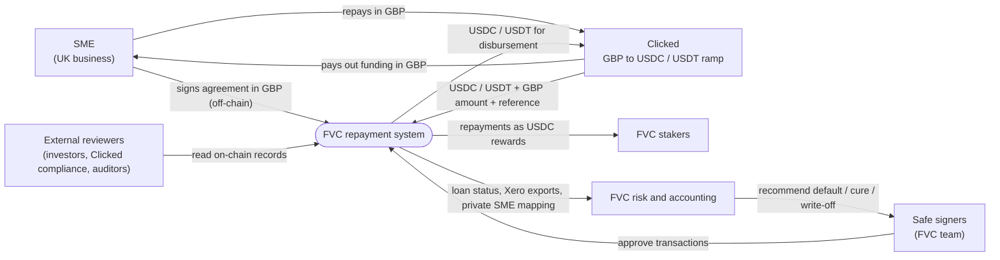
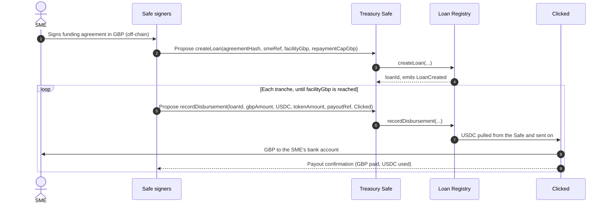
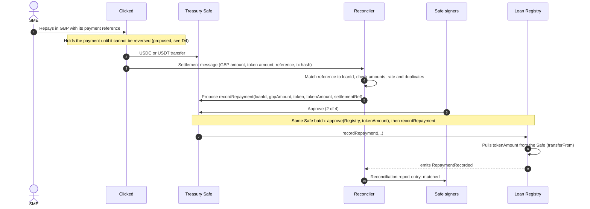
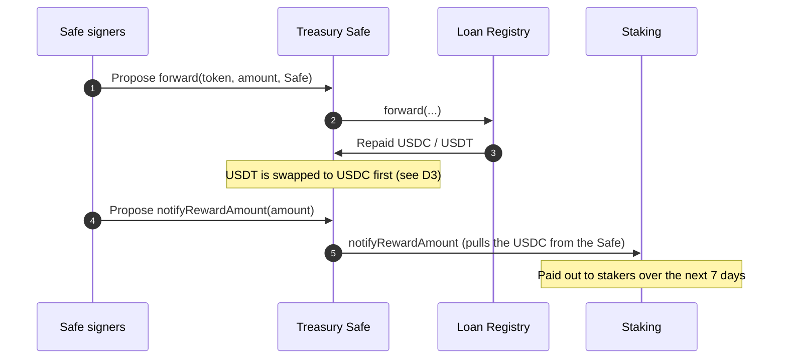
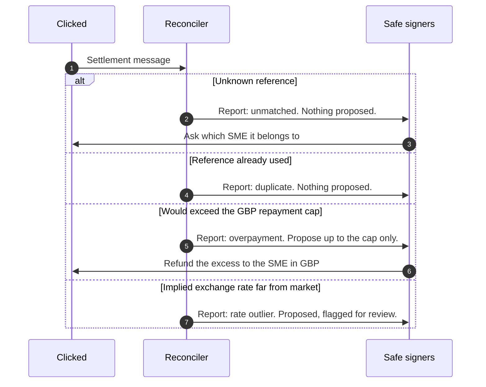

# SME repayment system: system spec

Status: draft, 8 Nov 2026. Covers how money moves between FVC, its payments partner and the
businesses it funds. Build order: [`development-plan.md`](./development-plan.md). Component specs go deeper:

| Component | Spec | State |
|---|---|---|
| Loan Registry | [`contracts/LOAN_REGISTRY.md`](../../contracts/LOAN_REGISTRY.md) | Specified; contract not written |
| Clicked integration | `docs/specs/clicked-integration.md` | Not written |
| Reconciler | `docs/specs/reconciler.md` | Not written |
| Staking | [`contracts/src/staking/Staking.sol`](../../contracts/src/staking/Staking.sol) | Written and tested; not deployed |

---

## 1. Purpose

FVC funds UK SMEs with interest-free, revenue-share agreements written in pounds. The SMEs repay in
GBP; Clicked converts each repayment to USDC or USDT and settles it to FVC on Ethereum. Those
repayments should reach FVC stakers, and anyone (investors, Clicked's compliance team, auditors)
should be able to check what was lent, what was repaid and what is outstanding, without learning
who the SMEs are.

## 2. Scope

In scope: disbursing funding to an SME, collecting repayments, recording them on-chain, and paying
them out to stakers.

Out of scope: credit decisions, investor KYC, the token sale, vesting, governance, and non-UK SMEs
(CHF agreements can be added later as a second currency).

## 3. Actors

| Actor | Role |
|---|---|
| SME | UK business. Signs the agreement, receives funding in GBP, repays in GBP. Never touches crypto. |
| Clicked | Payments partner (contact: Saeed). Collects GBP, converts to and from USDC or USDT, quotes a payment reference and the GBP amount on every settlement. Still building its product; FVC is its first partner. |
| Treasury Safe | Gnosis Safe, 2 of 4 signers. Holds every admin role. |
| Safe signers | FVC people who approve each Safe transaction. |
| Stakers | FVC holders who stake and receive repayments in USDC. |
| Risk assessors (FVC) | Watch each loan's repayments against its cap, flag late payers, recommend default, cure or write-off. Read-only; also see the private loan-to-SME mapping. |
| Accounting (FVC) | Dan McManus's firm, using Xero. Books disbursements, repayments and payouts; reconciles the Safe, the Loan Registry and Clicked's statements. Read-only; also sees the private mapping. |
| External reviewers | Investors, Clicked compliance, auditors. Read-only, on-chain data only, unless given agreements under NDA. |
| Legal Bison | Drafts the funding agreement template. |

---

## 4. Context (C4 level 1)

Who talks to the system, and about what.

## 5. Containers (C4 level 2)

The parts inside FVC and how they connect. Dashed boxes do not exist yet.

```mermaid
flowchart TB
    subgraph offchain["Off-chain"]
        Agreement["Signed agreement PDF<br/>(Legal Bison template, GBP)"]
        Reconciler["Reconciler<br/>matches settlements to loans,<br/>proposes Safe transactions,<br/>produces Xero exports"]:::todo
        ClickedAPI["Clicked API / webhook"]:::todo
        Subgraph["Subgraph<br/>public dashboard data"]
    end

    subgraph onchain["Ethereum mainnet"]
        Safe["Treasury Safe<br/>2 of 4"]
        Registry["Loan Registry<br/>loans, repayments, totals"]:::todo
        Staking["Staking<br/>stake FVC, earn USDC<br/>over 7-day periods"]
        Stable["USDC / USDT<br/>(same as the Sale)"]
    end

    ClickedAPI -- "settlement events" --> Reconciler
    Stable -- "transfers into Safe" --> Reconciler
    Reconciler -- "proposed recordRepayment" --> Safe
    Agreement -- "keccak256 hash" --> Safe
    Safe -- "createLoan / recordRepayment / forward" --> Registry
    Registry -- "pulls tokens" --> Stable
    Safe -- "notifyRewardAmount" --> Staking
    Registry -- "events" --> Subgraph

    classDef todo stroke-dasharray: 5 5
```

---

## 6. Currency model

Agreements are in pounds, money on-chain is in dollars. The Loan Registry records both.

| Figure | Unit | Source | Used for |
|---|---|---|---|
| Facility (most FVC will pay out) and repayment cap | GBP (pence) | The signed agreement | Limit on tranches; deciding when a loan is fully repaid |
| Disbursed so far | GBP (pence) | Clicked's payout confirmation, per tranche | Risk view, Xero |
| Repayment counted against the cap | GBP (pence) | Clicked's settlement message: the GBP it collected | Outstanding balance, risk view, Xero |
| Repayment received | USDC or USDT (token units) | Pulled on-chain by the Loan Registry | Proving the money exists, payouts to stakers |

- A loan is `Repaid` when GBP repaid reaches the GBP cap. The token amount never decides that.
- The GBP figure is Clicked's report and cannot be checked on-chain. The token amount can. The
  reconciler keeps the implied exchange rate for each settlement so outliers stand out.
- FVC carries the exchange rate risk between disbursement and repayment.

---

## 7. Flows

### 7.1 Disbursement

### 7.2 Repayment

### 7.3 Payout to stakers

### 7.4 Unmatched or bad settlement

---

## 8. Requirements

### Must

- R1. Every recorded repayment is backed by USDC or USDT the Loan Registry actually received.
- R2. A settlement reference is credited at most once.
- R3. No loan is ever repaid past its GBP repayment cap.
- R4. No personal data on-chain. SMEs appear only as a salted hash.
- R5. Every state change goes through the Safe (2 of 4) until a spend-limited recorder role is agreed.
- R6. The reconciler never signs. It only proposes Safe transactions and reports.
- R7. Anyone can read loans, repayments and totals without an account.
- R8. Clicked only settles payments that can no longer be reversed, so a recorded repayment is final.
- R9. The private loan-to-SME mapping is stored off-chain, with access limited to FVC risk and
  accounting.
- R10. Each repayment records both the GBP amount (counts against the cap) and the token amount
  (the money received).

### Should

- R11. A public dashboard (subgraph) shows totals lent, repaid and outstanding in GBP, and tokens
  received.
- R12. External reviewers can verify a given agreement PDF against its on-chain hash.
- R13. Risk view: per loan, GBP repaid against the cap, date of the last repayment, and status,
  joined to the SME through the private mapping, so late payers stand out.
- R14. Xero export: bank statement CSVs, one file per holding (Safe USDC, Safe USDT, Loan Registry)
  per period, each set up as a bank account in Xero. Columns: date, amount (signed), payee,
  description (loan and type: disbursement, repayment, payout), reference (settlement reference or
  tx hash), plus the GBP amount and implied rate. Every line ties out against on-chain balances and
  Clicked's statements.
- R15. The Loan Registry goes through the same CI security checks as the existing contracts
  (unit tests, Foundry and Medusa fuzzing, Halmos, mutation testing, Slither, coverage floor).

## 9. Open decisions

| ID | Decision | Depends on | Owner |
|---|---|---|---|
| D2 | Payment reference format: Clicked-issued ID, or FVC issues one per SME | Clicked's product | Igli with Saeed |
| D3 | Does Clicked settle in USDC only, or also USDT (which must be swapped before Staking) | Clicked's product | Igli with Saeed |
| D4 | Chargebacks: does Clicked hold card payments until final, or can it claw back | Clicked's terms | Igli with Saeed |
| D5 | Publishing the agreement hash; consumer credit rules for sole traders | Legal review | Legal Bison |
| D6 | Clicked's legal entity, company number and licence (or licensed partner) | Clicked | Saeed |
| D8 | Is the repayment cap fixed in the agreement, or a multiple of what was actually paid out (for example 1.2 times the tranches drawn) | Agreement terms | Jaz |
| D7 | Accounting detail: how repayments split into principal and revenue-share income, per transaction or monthly summary, Xero column layout | Dan's firm | Igli with Dan |

## 10. Decision log

| Date | Decision | Reason | Agreed by |
|---|---|---|---|
| 8 Nov 2026 | D1: Ethereum mainnet, USDC and USDT | Same stablecoins as the Sale; Staking already pays USDC | Igli |
| 8 Nov 2026 | Agreements and caps in GBP; each repayment records GBP and token amounts | SMEs are UK businesses; agreements are in pounds | Igli |
| 8 Nov 2026 | Accounting package: Xero | Dan's recommendation | Dan, Igli |
| 8 Nov 2026 | Loans are facilities paid out in tranches; repayments any amount, any time, until the GBP cap | Paying a whole loan at once is unrealistic | Igli |
