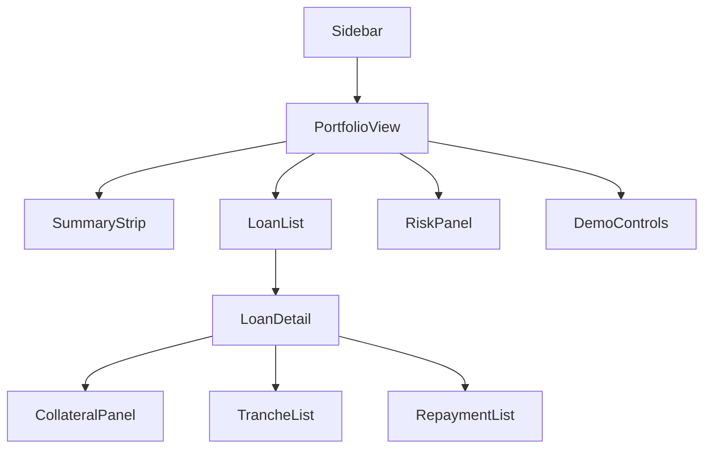
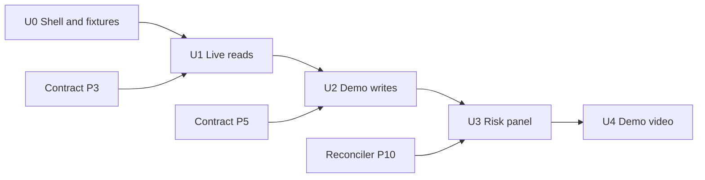

# UI plan: Loan portfolio and risk views

Status: draft, 18 Nov 2026. Goal: a demoable UI in the existing investor dapp that shows
loans, collateral, repayments and risk status, using **only** the dapp's current components,
colours, fonts and layout. No new design system.

Read with:

- [`docs/specs/system.md`](./system.md)
- [`docs/specs/development-plan.md`](./development-plan.md)
- Live templates: `dapp/src/components/cards/StakingCard.tsx`,
  `dapp/src/components/cards/VestingDashboard/VestingDashboard.tsx`,
  `dapp/src/components/ui/*`

---

## 1. Why a UI, and who it is for

SMEs never use this UI. They only use their bank and, later, the partner. This screen is **FVC's
internal portfolio view**: what we track on each loan. The first demo is for **the partner and its
team**, so they can see the fields, collateral and repayment flow their settlement feed will plug
into.

The Loan Registry is also public on Etherscan, but a filmed walkthrough of the dapp is clearer for
his compliance team than raw contract calls.

| Audience | What they need | How they see it |
|---|---|---|
| Partner team | What FVC tracks; where their feed fits | Private demo video + optional Sepolia link |
| Safe signers / FVC ops | Loan status, collateral, repayments | `#/portfolio` in the dapp |
| Risk / Dan | Same numbers, risk flags, Xero cross-check | `#/portfolio` |
| SMEs | Nothing in this dapp | Bank + the partner only |
| Public investors | Anonymised totals later | Not in v1 of this tab |

---

## 2. Hard style rules (anti-AI look)

Copy the live dapp. Do not invent a parallel kit.

| Concern | Use this | Do not |
|---|---|---|
| Shell | `AppBar`, `Sidebar`, `MainLayout`, `TabContent`, `CenteredFlexCol` | New layout, light theme, dashboards with cards everywhere |
| Card chrome | shadcn `Card` / `CardHeader` / `CardTitle` / `CardDescription` / `CardContent` from `components/ui/card.tsx` (glass: `rounded-xl border-white/10 bg-black/20 backdrop-blur`) | New card systems, purple gradients, cream backgrounds |
| Buttons / inputs | `Button`, `Input` from `components/ui/` | One-off hex buttons, rounded-full pill clusters |
| Stats list pattern | VestingDashboard: 3-stat grid, nested list cards, status states | New chart libraries, emoji-heavy empty states |
| Form pattern | StakingCard: max-w ~480, 2-col stats, toggle, Input + Button | Floating badges, multi-shadow chrome |
| Colours | Cyan `#38BDF8` / `cyan-500`, success `#10B981`, warning `#F59E0B`, error `#EF4444`, surfaces `#0A0A0A` / `#1A1A1A`, borders `white/10` | New palette |
| Fonts | Inter + Space Grotesk (already in `globals.css`) | New font families |
| Icons | Existing `lucide-react` / `react-icons` usage | New icon packs, emoji as primary nav (Sidebar already uses emoji; keep that pattern only in Sidebar) |
| States | disconnected / missing config / loading / error+retry / empty / data (VestingDashboard) | Skeleton-only pages with no empty copy |

PR checklist for every UI phase: screenshot side-by-side with Staking or Vesting; if it looks like a
different product after removing the logo, reject it.

---

## 3. Screens to build

One new tab: **Portfolio** (`portfolio`). Hash: `#/portfolio`.

### 3.1 Portfolio summary strip

Top of the tab. Three to four stats, VestingDashboard style:

- Facility drawn (GBP)
- Outstanding (GBP)
- Collateral held (USDC / USDT)
- Active / defaulted / repaid counts

Reuse local `StatCard` pattern from VestingDashboard (or extract a shared `StatCard` into
`components/ui/` only if both screens can share it without restyling).

### 3.2 Loan list

List of loans, each a nested card:

- Loan ID
- Status chip (`Active`, `Defaulted`, `Repaid`, `WrittenOff`) using existing success / warning / error colours
- Facility / drawn / repaid / owed (GBP)
- Collateral held
- Last repayment date

Click opens Loan detail.

### 3.3 Loan detail

Single loan page inside the same tab (no new route; expand or replace list like Vesting schedules):

- Agreement hash (shortened, copy button)
- Progress bar: repaidGbp / owedGbp (same bar pattern as VestingDashboard)
- Collateral panel: deposited, held, released, claimed
- Tranche list
- Repayment list (GBP amount, token amount, implied rate, settlement ref, tx link)

### 3.4 Risk panel

Second section or sub-toggle on Portfolio (like Staking stake/unstake toggle):

- Loans with no repayment in N days
- Outstanding above a threshold
- Defaulted with unclaimed collateral

No personal SME names on-chain. For internal demos, a local-only mapping file can show a display
name; that file is never committed (same rule as the private loan-to-SME mapping).

### 3.5 Demo controls (dev / Sepolia only)

Hidden behind `NEXT_PUBLIC_DEMO_MODE=true`. Lets you film without the partner:

- Seed a facility
- Deposit collateral
- Record a tranche
- Record a repayment
- Release or claim collateral

These call the Loan Registry from a funded demo wallet. On mainnet this flag is off.

---

## 4. Registration (exact files)

| Step | File |
|---|---|
| Add tab id | `dapp/src/constants/tabs.ts` → `VALID_TAB_IDS`, `MOBILE_TABS` |
| Sidebar entry | `dapp/src/components/layout/Sidebar.tsx` → `tabs` array (same structure as Investor / Staking) |
| Switch case | `dapp/src/components/layout/TabContent.tsx` |
| Screen | `dapp/src/screen-view/PortfolioView.tsx` |
| Cards | `dapp/src/components/cards/PortfolioSummaryCard.tsx`, `LoanListCard.tsx`, `LoanDetailCard.tsx`, `RiskPanelCard.tsx`, `DemoControlsCard.tsx` |
| Contract utils | `dapp/src/utils/contracts/loanRegistry.ts` (ABI, address, hooks; mirror `vestingContract.ts`) |
| Env | `NEXT_PUBLIC_LOAN_REGISTRY_ADDRESS`, `NEXT_PUBLIC_DEMO_MODE` |

Do not revive the unused `private-sale` or `governance` tabs for this. Portfolio is a new id.

---

## 5. Data and mock strategy (so you can demo before the partner)

| Stage | Data source | What the video shows |
|---|---|---|
| U0 Wireframe in dapp | Hardcoded fixtures in `DemoControls` / fixture JSON | Tab, list, detail layout matching Staking/Vesting |
| U1 After contract P1 to P5 on Hardhat / Sepolia | Real contract reads; demo wallet writes | Create → collateral → tranche → repay → release |
| U2 After reconciler P10 | Mock partner feed → Safe proposal → record | Ops path without naming the partner publicly |
| U3 Partner sandbox | Real partner feed | Partner demo; film only with written consent |

Fixture rule: amounts in GBP (pence) and USDC (6 decimals), same as the contract tests. One sample
loan: facility £100,000, collateral £20,000 (20%), two tranches of £50,000, three repayments.

---

## 6. UI phases (attach to the contract plan)

### U0: shell + fixtures (in progress)

No contract required. First cut for partner walkthroughs.

- [x] Add `portfolio` tab end to end (tabs, Sidebar, TabContent, PortfolioView)
- [x] Summary strip + loan list + loan detail with fixture data
- [x] Payments partner feed placeholder (`Not connected`, simulated rows)
- [ ] Match StakingCard and VestingDashboard visually (screenshot check on local run)
- [ ] Empty / loading states when fixtures are later swapped for live reads

**Gate:** open `#/portfolio` on local dapp; it looks like the rest of the app; fixtures tell a full
loan story including collateral and the partner feed placeholder.

### U1: live reads (after contract P3 on Sepolia)

- [ ] `loanRegistry.ts` with `useReadContract` / `useReadContracts` (loan count, loans, collateralHeld, events)
- [ ] Replace fixtures when `NEXT_PUBLIC_LOAN_REGISTRY_ADDRESS` is set; keep fixtures as fallback in demo mode
- [ ] Etherscan links for txs (same pattern as existing explorer links if any; else `https://etherscan.io/tx/...`)

**Gate:** a Sepolia loan created by script appears in the list without refreshing hacks.

### U2: demo writes (after contract P5)

- [ ] DemoControlsCard (demo mode only): deposit collateral, tranche, repay, release, claim
- [ ] Toasts via existing toaster
- [ ] Disable all write buttons when demo mode is off

**Gate:** one person can drive a full lifecycle in under 5 minutes for a screen recording.

### U3: risk panel + reconciler status (after P10)

- [ ] RiskPanelCard from on-chain status + last repayment timestamps
- [ ] Optional read-only strip: "N Safe proposals pending" if reconciler exposes a status endpoint
- [ ] No SME names unless local mapping file present

**Gate:** defaulted loan with collateral still held is visibly flagged.

### U4: demo video package

Follow [`demo-tour-plan.md`](./demo-tour-plan.md) phases T1 to T5.

- [ ] In-app Demo Tour (pan + captions)
- [ ] 1080p60 recording
- [ ] Private link for the partner; do not name them unless consent is written

**Gate:** The partner can forward an ~80 second captioned clip to their team.

---

## 7. Demo video (for the payments partner)

Full plan: [`demo-tour-plan.md`](./demo-tour-plan.md).

In-app Demo Tour (smooth pan + captions), then 60fps capture. About 75 seconds. Captions cover:
Portfolio header → summary → active facility → collateral → partner feed placeholder → repaid
example with collateral released. Say "payments partner" unless the partner consents to being named.

---

## 8. What this UI is not

- Not an SME portal (they stay on bank and partner rails)
- Not a Safe replacement (signers still approve in Safe)
- Not a redesign of Dashboard, Investor, Staking or Roadmap
- Not a public naming of the partner until the partnership is signed
- Not Xero itself (export stays in the reconciler; UI only confirms figures)

---

## 9. Definition of done

- `#/portfolio` ships in the existing shell and cannot be mistaken for a different product
- A Sepolia demo wallet can complete collateral → draw → repay → release on camera
- Risk can spot a late or defaulted loan without reading the contract
- The partner has a private video link that answers "how does collateral move through your system?"
